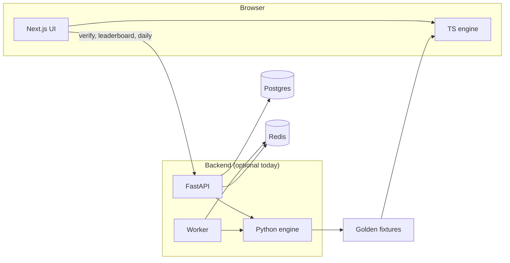

# Detonate

**Competitive Minesweeper.** Clear the board. Don't detonate.

Detonate is a full-stack project built around a **deterministic, replayable** Minesweeper engine. The browser game runs entirely on the client; the Python backend is the authority for rules, verified runs, leaderboards, the daily board, and player accounts.

Repository: [github.com/NethmaDS123/Detonate](https://github.com/NethmaDS123/Detonate)

## Why this repo

- **Two engines, one contract.** Canonical game logic lives in Python (`backend/packages/engine`). A TypeScript port powers the UI (`frontend/packages/engine`). Golden JSON fixtures exported from Python are replayed in Vitest so both implementations stay aligned.
- **Built for competition, playable offline.** Seeded boards, event-based moves (reveal, flag, chord), and snapshots support fair verification later without blocking casual play now.
- **Split for real deployment.** Frontend (Next.js) and backend (FastAPI + worker) are separate apps in one monorepo—each can be hosted on its own origin when you go to production.

## Tech stack

| Layer | Technologies |
| --- | --- |
| UI | Next.js 16, React 19, TypeScript, Tailwind CSS 4 |
| Client engine | TypeScript package (`@detonate/engine`), Vitest |
| API | FastAPI, OpenAPI at `/docs` |
| Server engine | Python 3.12+, pytest, uv workspace |
| Infra (ready) | Docker Compose — Postgres 16, Redis 7 |

## Features

### Shipped

- Browser Minesweeper with **Beginner** (9×9, 10 mines), **Intermediate** (16×16, 40), and **Expert** (30×16, 99).
- Standard controls: left-click reveal, right-click flag, chord on a revealed number when adjacent flags match.
- **Safe first click** — mines are placed after the opening click; the clicked cell and its neighbors (when possible) are never mines.
- **Seeded boards** — same seed yields the same mine field; new board generates a new seed.
- Mine counter, timer, win/loss handling (auto-flag on win, reveal mines on loss).
- Backend **health**, **readiness** (Postgres + Redis checks), **`GET /v1/difficulties`**, and **`POST /v1/runs/verify`** (replay move log with the canonical engine).
- On win, the UI sends your move log to the API when it is reachable and shows **verified** when the server agrees; verified wins are **stored in Postgres** when the database is up (tagged **random** or **daily** with a `dailyId` like `YYYY-MM-DD:difficulty`).
- **Leaderboard** of the fastest verified times per difficulty (`GET /v1/leaderboard`), shown beside the board and on its own page. Your latest saved win is marked when it places. UI labels leaderboards as **verified only** and explains that offline or unverified clears stay casual.
- **Daily leaderboard** — fastest verified clears on today’s shared board only (`GET /v1/daily/leaderboard`); shown on Daily play and on the Leaderboard page under **Today’s daily**.
- **Daily rank on clear** — after a verified daily win, the result screen shows your place on that day’s board (`#n / total` from `POST /v1/runs/verify`).
- **Personal bests** — signed-in players get fastest verified **classic** and **daily** times per difficulty (`GET /v1/accounts/me/bests`); new bests and current PBs show after a win and on the account page.
- **Share result** — after a game, **Share** copies a score line plus a link; classic links include the seed (`/play?…&seed=`), daily links open today’s board (`/daily?…&from=share`).
- **Share preview** — shared `/share/r?…` links expose Open Graph/Twitter cards (generated image with time, rank, mini grid) and a **Play this board** button.
- **Daily board** — one shared seed per difficulty per UTC day (`GET /v1/daily`); the worker publishes seeds to Redis, with the same deterministic fallback when Redis is empty. Daily submissions must match that day's seed (today or yesterday, UTC) or they are rejected.
- **Daily branding** — `Daily #N` day index (epoch 2026-01-01 UTC), board size and mine count, and today’s best verified time on Daily play, leaderboard, and `GET /v1/daily`.
- **Accounts** — **Clerk + Google** sign-in when configured; production beta uses **Google-only** (`NEXT_PUBLIC_CLERK_ONLY`). New users **choose a username** then get a **first-run tour** (modals for Daily, Classic, leaderboards, controls). **`PATCH /v1/accounts/me`** updates name or marks onboarding complete.
- **Legacy token accounts** — still supported when Clerk is off or `NEXT_PUBLIC_CLERK_ONLY=0`; **`POST /v1/accounts/clerk/link`** migrates tokens to Google.
- **App pages** — home with **Play today’s board**, live daily stats when the API is up, **Daily** and **Classic** play screens with difficulty tabs, a full **Leaderboard** page, and an **Account** page for creating an account or signing in with a token; the header shows who is signed in.
- Engine tests on both stacks; fixture export script to sync TS tests after Python rule changes.

## Production

**Public beta:** **[`docs/LAUNCH.md`](docs/LAUNCH.md)** — Vercel frontend, Render API, Supabase Postgres, Upstash Redis, Clerk Google sign-in, first-run username + tour.

Dockerfiles and env reference: **[`docs/DEPLOY.md`](docs/DEPLOY.md)**.

## Architecture



Play does **not** require the API. Postgres stores verified wins and serves the leaderboard. Redis holds published daily seeds (run the worker once per UTC day, or rely on the API fallback).

## Project layout

```
Detonate/
├── frontend/          # Next.js app + @detonate/engine
├── backend/
│   ├── apps/api/      # HTTP API
│   ├── apps/worker/   # Daily board publish
│   ├── packages/engine/
│   └── fixtures/      # Exported golden replays
└── README.md          # You are here
```

Details: [`frontend/README.md`](frontend/README.md) · [`backend/README.md`](backend/README.md)

## Quick start

### Play locally (frontend only)

Requires Node 22+ and pnpm 10.

```bash
git clone https://github.com/NethmaDS123/Detonate.git
cd Detonate/frontend
pnpm install
pnpm dev
```

Open [http://localhost:3000](http://localhost:3000).

### Backend (API + engine)

Requires Python 3.12+ and [uv](https://docs.astral.sh/uv/).

```bash
cd Detonate/backend
uv sync --all-packages --group dev
uv run --package detonate-api uvicorn detonate_api.main:app --reload --port 8000
```

- Health: [http://localhost:8000/health](http://localhost:8000/health)  
- API docs: [http://localhost:8000/docs](http://localhost:8000/docs)  

Optional: `docker compose up -d` in `backend/` for Postgres and Redis before using `/ready`.

## Tests

GitHub Actions runs backend (engine + API with Postgres) and frontend engine tests on every push to `main` and on pull requests.

```bash
# Python engine (authoritative)
cd backend && uv run pytest packages/engine/tests

# TypeScript engine vs exported fixtures
cd frontend && pnpm test:engine
```

After changing Python engine rules:

```bash
cd backend
uv run --package detonate-engine python packages/engine/scripts/export_fixtures.py
cd ../frontend && pnpm test:engine
```

## Engine rules (summary)

- Moves: `reveal`, `flag`, `chord`.
- Mine placement uses a seeded xorshift RNG after the first reveal.
- Win: all non-mine cells revealed. Loss: any mine revealed (including failed chord).

---

Built by [@NethmaDS123](https://github.com/NethmaDS123).
