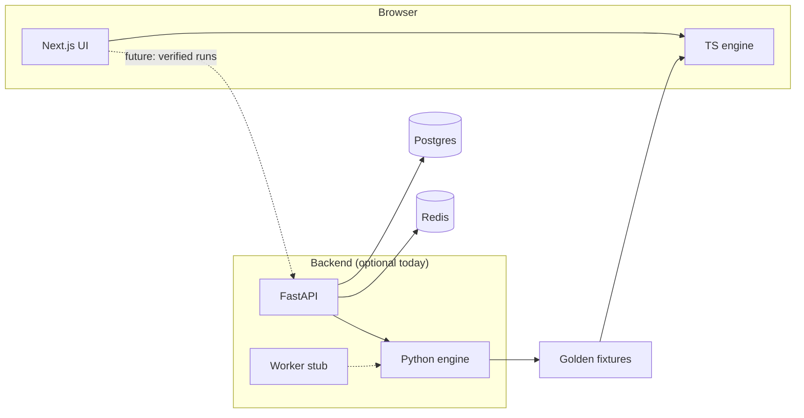

# Detonate

**Competitive Minesweeper.** Clear the board. Don't detonate.

Detonate is a full-stack project built around a **deterministic, replayable** Minesweeper engine. The browser game runs entirely on the client today; the Python backend is the authority for rules and will back verified runs, daily boards, and leaderboards as those features ship.

Repository: [github.com/NethmaDS123/Detonate](https://github.com/NethmaDS123/Detonate)

## Why this repo

- **Two engines, one contract.** Canonical game logic lives in Python (`backend/packages/engine`). A TypeScript port powers the UI (`frontend/packages/engine`). Golden JSON fixtures exported from Python are replayed in Vitest so both implementations stay aligned.
- **Built for competition, playable offline.** Seeded boards, event-based moves (reveal, flag, chord), and snapshots support fair verification later without blocking casual play now.
- **Split for real deployment.** Frontend (Next.js) and backend (FastAPI + worker) are separate apps in one monorepo—each can be hosted on its own origin when you go to production.

## Tech stack

| Layer | Technologies |
| --- | --- |
| UI | Next.js 16, React 19, TypeScript, Tailwind CSS 4 |
| Client engine | TypeScript package (`@detonate/engine`), Vitest |
| API | FastAPI, OpenAPI at `/docs` |
| Server engine | Python 3.12+, pytest, uv workspace |
| Infra (ready) | Docker Compose — Postgres 16, Redis 7 |

## Features

### Shipped

- Browser Minesweeper with **Beginner** (9×9, 10 mines), **Intermediate** (16×16, 40), and **Expert** (30×16, 99).
- Standard controls: left-click reveal, right-click flag, chord on a revealed number when adjacent flags match.
- **Safe first click** — mines are placed after the opening click; the clicked cell and its neighbors (when possible) are never mines.
- **Seeded boards** — same seed yields the same mine field; new board generates a new seed.
- Mine counter, timer, win/loss handling (auto-flag on win, reveal mines on loss).
- Backend **health**, **readiness** (Postgres + Redis checks), and **`GET /v1/difficulties`**.
- Engine tests on both stacks; fixture export script to sync TS tests after Python rule changes.

### Roadmap

Not implemented yet; names and stubs exist in the codebase.

| Feature | Intent |
| --- | --- |
| Verified runs | Submit a replay of moves; server re-simulates with the canonical engine. |
| Daily board | One shared seed per day via the worker. |
| Leaderboards | Ranked times tied to verified runs; UI uses `NEXT_PUBLIC_API_URL`. |
| Accounts | Identity for ranked play. |

## Architecture



Play does **not** require the API. Postgres and Redis are only needed for `/ready` and upcoming ranked features.

## Project layout

```
Detonate/
├── frontend/          # Next.js app + @detonate/engine
├── backend/
│   ├── apps/api/      # HTTP API
│   ├── apps/worker/   # Daily board / jobs (placeholder)
│   ├── packages/engine/
│   └── fixtures/      # Exported golden replays
└── README.md          # You are here
```

Details: [`frontend/README.md`](frontend/README.md) · [`backend/README.md`](backend/README.md)

## Quick start

### Play locally (frontend only)

Requires Node 22+ and pnpm 10.

```bash
git clone https://github.com/NethmaDS123/Detonate.git
cd Detonate/frontend
pnpm install
pnpm dev
```

Open [http://localhost:3000](http://localhost:3000).

### Backend (API + engine)

Requires Python 3.12+ and [uv](https://docs.astral.sh/uv/).

```bash
cd Detonate/backend
uv sync --all-packages --group dev
uv run --package detonate-api uvicorn detonate_api.main:app --reload --port 8000
```

- Health: [http://localhost:8000/health](http://localhost:8000/health)  
- API docs: [http://localhost:8000/docs](http://localhost:8000/docs)  

Optional: `docker compose up -d` in `backend/` for Postgres and Redis before using `/ready`.

## Tests

```bash
# Python engine (authoritative)
cd backend && uv run pytest packages/engine/tests

# TypeScript engine vs exported fixtures
cd frontend && pnpm test:engine
```

After changing Python engine rules:

```bash
cd backend
uv run --package detonate-engine python packages/engine/scripts/export_fixtures.py
cd ../frontend && pnpm test:engine
```

## Engine rules (summary)

- Moves: `reveal`, `flag`, `chord`.
- Mine placement uses a seeded xorshift RNG after the first reveal.
- Win: all non-mine cells revealed. Loss: any mine revealed (including failed chord).

---

Built by [@NethmaDS123](https://github.com/NethmaDS123).
